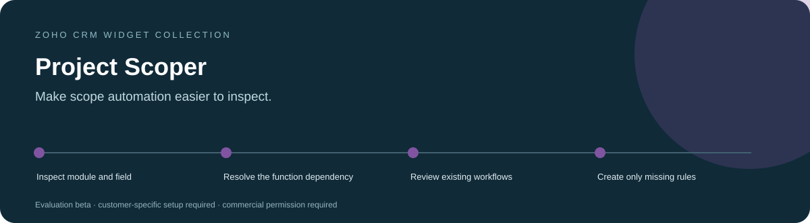
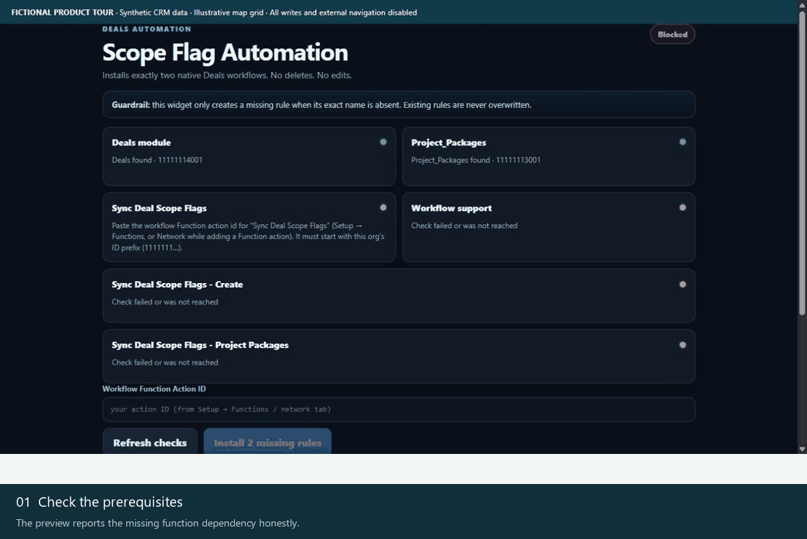
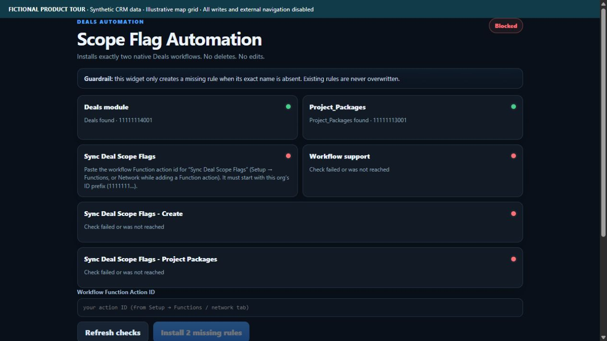
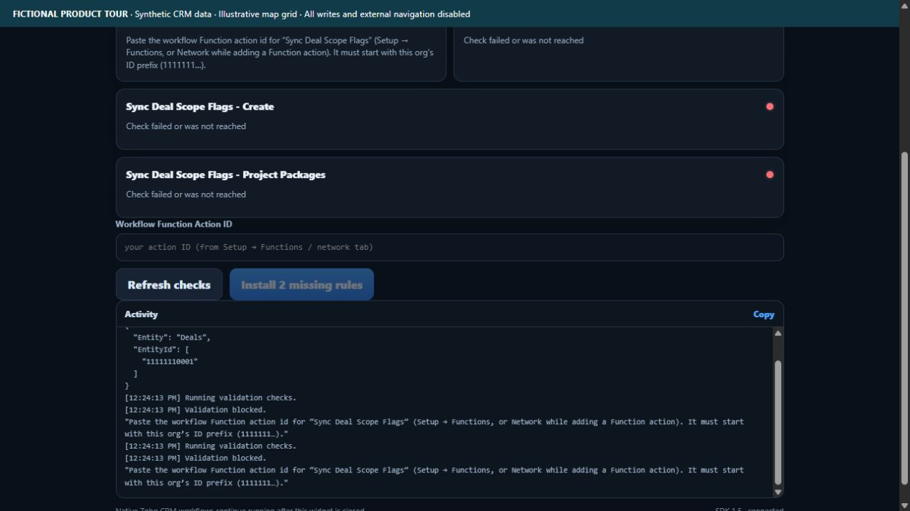
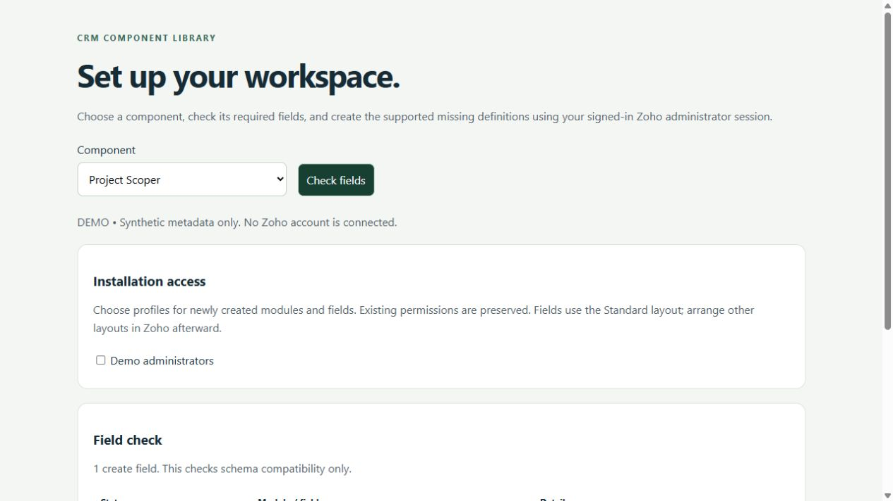

<h1 align="center">Project Scoper for Zoho CRM</h1>

<strong>Make scope automation easier to inspect.</strong> An administrator workspace for checking the Deals module, Project_Packages field, function-action discovery and scope workflow configuration.

Tested &amp; In Development / Pre-Release · Development showcase and fictional-data tours

> **Tested & In Development / Pre-Release.** Testing covers documented development checks only. Production readiness and customer-specific acceptance remain pending.

> [!IMPORTANT]
> **Showcase only.** This public repository contains product information and fictional demonstration media. It provides no software source, installable packages, free beta downloads or software license. Release availability remains pending; any future deployment scope will be agreed privately. Product validation and the limitations below still apply.

[Discuss a commercial installation](https://github.com/RawPowered/Zoho-Project-Scoper/issues/new?template=commercial-inquiry.yml) · [Deployment model](DEPLOYMENT.md) · [Commercial terms overview](COMMERCIAL.md)

## A focused workspace

CRM administrators installing or reviewing project-scope automation.

| Capability | What it helps with |
| --- | --- |
| **Visible prerequisites** | Inspect module and field metadata before attempting workflow setup. |
| **Action discovery** | Find the workflow function action or validate an explicitly supplied action ID. |
| **Missing-rule setup** | Offer creation of the configured missing workflow rules after prerequisite checks pass. |

## Product tour

These captures show the actual widget running against an isolated fictional-data adapter. No customer account, real person, customer branding or production credential is used. CRM writes and outbound navigation are blocked. Map backgrounds are illustrative grids; required third-party attribution is retained.

### Watch the workflow

The animation is a sequence of actual interface states, held for readability. It is not a recording of a live customer installation.

### Start with the workspace

The preview reports the missing function dependency honestly.

### Follow the next actions

<table><tr><td width="50%"><strong>Re-run the checks</strong>
Setup remains blocked until the required action is supplied.
</td><td width="50%"><strong>Inspect the field plan</strong>
Field setup is separate from deploying the missing function.
</td></tr></table>

### Prepare the account deliberately

A separately licensed Schema Setup companion can be scoped to this product. It reads field metadata, identifies compatible existing definitions, and distinguishes missing definitions from manual steps. A field plan does not certify that functions, workflows or permissions are complete.

All records and sample labels are fictional. Preview tooling and installable software are not distributed through this public showcase. Commercial deployment still requires the documented account-specific acceptance checks.

## Commercial deployment

Licensed widget packages are supplied privately for the agreed customer organization. An authorized administrator installs them directly inside Zoho CRM using **Zoho internal hosting**, sets the supplied entry page and attaches the intended CRM placement. A Settings or Web Tab administrator widget.

Schema, access profiles, workflows and service connections are reviewed for the licensed installation. A showcase screenshot does not certify compatibility or complete those steps. WordPress integration, where licensed, runs on the customer's live WordPress host and is configured separately. [How the platforms fit together](DEPLOYMENT.md).

## Data access and responsibilities

**Reads:** Deals metadata, Project_Packages field metadata, function-action metadata, workflow configuration and existing workflow rules.

**Writes:** The install action can create missing workflow rules. A selected function-action ID is stored in the browser's local storage. The companion Schema Setup can create supported missing field definitions after explicit review.

**External services:** Zoho's signed-in SDK/ZRC session. No third-party API key is collected.

## Current product boundaries

- BLOCKED for a complete installation: Sync Deal Scope Flags must be supplied and tested first.
- Creating a workflow rule does not prove the called function is correct.
- Existing workflow rules are not automatically rewritten or repaired.

Status: **Tested & In Development / Pre-Release**. Account-specific acceptance is required before production activation. Credentials and customer data are configured privately in the customer environment.

## Commercial availability

Request licensing, installation, account mapping or support through a [commercial inquiry](https://github.com/RawPowered/Zoho-Project-Scoper/issues/new?template=commercial-inquiry.yml). Include only a general use case; public issues must not contain customer records, account IDs, secrets or confidential details. Pricing, permitted organizations/users, delivery scope and support terms are agreed privately. This page does not collect payment or grant permission to use the software.

## Explore the collection

[Widget collection](https://github.com/RawPowered/Zoho-CRM-Widgets) · [Automation overview](https://github.com/RawPowered/Zoho-CRM-Automations) · [PowerPortals](https://github.com/RawPowered/PowerPortals-Showcase)

- [Service Map](https://github.com/RawPowered/Zoho-Service-Map)
- [Get Directions](https://github.com/RawPowered/Zoho-Get-Directions)
- [Service Map Dashboard](https://github.com/RawPowered/Zoho-Service-Map-Dashboard)
- [CEO Pipeline](https://github.com/RawPowered/Zoho-CEO-Pipeline)
- [Parts and Scope Builder](https://github.com/RawPowered/Zoho-Parts-and-Scope-Builder)
- [Project Task Builder](https://github.com/RawPowered/Zoho-Project-Task-Builder)
- [Financial Scope](https://github.com/RawPowered/Zoho-Financial-Scope)
